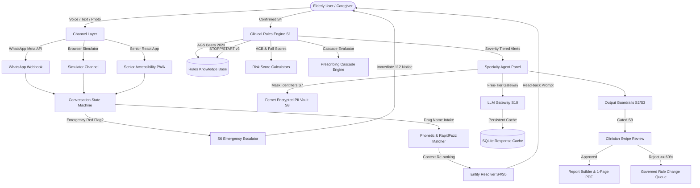

# MedGuard Architecture Specification

MedGuard is engineered as a privacy-preserving, deterministic decision-support platform for geriatric medication safety.

---

## 1. System Overview

---

## 2. Core Subsystems

### 2.1 Entity Resolution & Indian Brand Normalization (`backend/app/entities/`)
- **Lexicon:** Seeds 171 common Indian pharmaceutical brands, 157 canonical generics, and 7 AYUSH/herbal formulations.
- **Scoring Pipeline:** Composite scoring function:
  $$\text{Score} = 0.5 \cdot \text{StringSimilarity} + 0.3 \cdot \text{MetaphonePhonetic} + 0.2 \cdot \text{ASRConfidence}$$
- **Safety Cap:** Clinical context re-ranking (priors from age, existing prescriptions) can adjust candidate ranking but is hard-capped below the auto-accept threshold (0.90) to prevent unauthorized promotions.
- **Confirm-Before-Store (S4):** Extracted medications only enter the active database after explicit senior confirmation.

### 2.2 Deterministic Clinical Rules Engine (`backend/app/rules/`)
- Encodes 10 distinct rule categories:
  1. `duplicate_ingredient`: Cumulative dosing hazards (e.g. Paracetamol).
  2. `duplicate_class`: Multiple NSAIDs or duplicate ARBs.
  3. `interaction_pair`: Pairwise hazards (Warfarin + NSAID, Warfarin + Antiplatelet, SSRI + NSAID).
  4. `interaction_combo`: Multi-drug combos (The "Triple Whammy" ARB/ACEi + Diuretic + NSAID).
  5. `beers_pim`: Beers 2023 criteria for seniors (Benzodiazepines, 1st-gen Antihistamines).
  6. `duration_exceeded`: Time-on-drug limits (PPI therapy > 8 weeks).
  7. `renal_threshold`: Impairment thresholds (Metformin, Spironolactone, NSAIDs in CKD).
  8. `cascade`: Prescribing cascade sequences (CCB &rarr; Loop Diuretic).
  9. `herbal_interaction`: AYUSH interactions (Ashwagandha, Ginkgo, Turmeric with anticoagulants).
  10. `drug_condition`: Contraindications with documented comorbidities (NSAIDs in Peptic Ulcer Disease).

### 2.3 Privacy & PII Vault (`backend/app/privacy/`)
- **Token Masking (S7):** Strips names, phone numbers, addresses, and dates of birth. Replaces them with consistent surrogate tokens (`PT-XXXX`).
- **Encrypted Vault (S8):** Encrypts direct patient identifiers with Fernet symmetric keys (`AES-128-CBC` with `HMAC-SHA256`) stored in an isolated vault table.
- **Full Purge Right:** Compliant with DPDP (India) and GDPR deletion rights; purging a patient deletes all medications, alerts, scores, and unrecoverably zeroes their encrypted vault entries.

### 2.4 Specialty Deliberation Panel & LLM Gateway (`backend/app/agents/`)
- **Panel Specialists:** Cardiology, Nephrology, Geriatrics/Neurology, and GI/Bleeding.
- **Moderator:** Reconciles specialist viewpoints into neutral doctor questions. It surfaces clinical trade-offs without forcing false consensus.
- **LLM Gateway:**
  - Token-bucket rate limiter (15 RPM).
  - Session call budget (max 20 calls/session) and daily budget (1,500 calls/day).
  - Exponential backoff with jitter on 429 / 503 errors.
  - Automatic circuit breaker tripping to deterministic rules fallback if external API is unreachable.
  - Persistent SQLite response cache enabling 100% offline demonstration.

### 2.5 Clinician Review & Governed Feedback Loop (`backend/app/review/`)
- **Review Queue:** Severity-ranked card queue.
- **Decisions:** Agree (releases alert and commentary), Reject (requires reason tag), Needs Info.
- **10-Second Undo:** Accidental swipes can be reversed within 10 seconds.
- **Audited Reveal:** Patient identity remains masked by default; viewing real names requires an audited clinical justification.
- **Rule Change Proposal:** When a rule receives &ge; 60% rejections across 5+ reviews, a `RuleChangeProposal` is created with aggregated evidence for administrator review. Rules are never modified automatically.

---

## 3. Storage Architecture

- **Database:** SQLite for lightweight local deployment (`medguard.db`) or PostgreSQL via `DATABASE_URL`.
- **Append-Only Audit Log:** Tracks all intake actions, rule evaluations, identity reveals, caregiver notifications, and review decisions.

