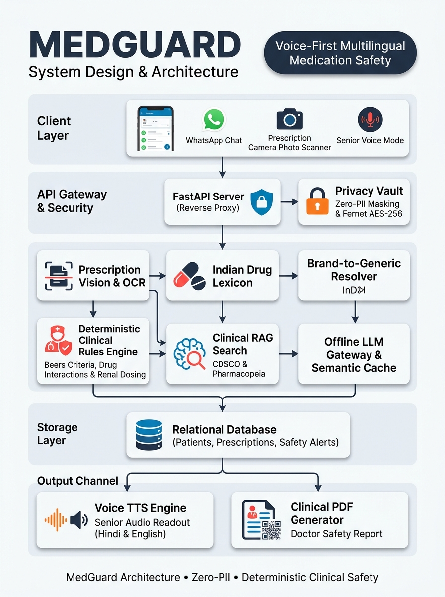

# MedGuard — Voice-First Multilingual Medication-Safety Assistant

MedGuard is an accessible, voice-first medication-safety assistant designed for elderly people in India. It collects a senior's full medication picture (prescriptions, OTC drugs, supplements, and AYUSH/herbal formulations) from voice notes, photos, and text, normalizes them to canonical generic ingredients, evaluates them with a deterministic clinical rules engine, and produces a structured **Doctor Discussion Guide**.

<p align="center">
  
</p>

> [!IMPORTANT]
> **Decision Support Only:** MedGuard is a communication and decision-support aid. It is **not a doctor and does not diagnose, prescribe, or direct patients to stop or change therapy.** All alerts formulate neutral questions for the prescribing physician.

---

## Headline Capabilities

1. **Voice-First Multilingual Interaction:** Native support for English, Hindi (हिंदी), and Kannada (ಕನ್ನಡ) with Indian pharmaceutical brand recognition.
2. **Deterministic Clinical Rules Engine (Zero Hallucinations):** Evaluates 10 distinct rule types grounded in the 2023 AGS Beers Criteria®, STOPP/START v3, and the Anticholinergic Cognitive Burden (ACB) scale.
3. **Multi-Specialty Agent Deliberation Panel:** Cardiology, Nephrology, Geriatrics/Neurology, and GI/Bleeding domain agents moderated neutrally without forced consensus.
4. **Senior Accessibility PWA:** Scalable typography (&ge; 22px base, scalable to 200%), high-contrast WCAG AAA theme, large touch targets (&ge; 56px), and one-tap emergency calling (112).
5. **Caregiver Dashboard:** Real-time visibility into medication regimens, active risk alerts, symptom logs, and PDF guide exports.
6. **Clinician Swipe Review Queue:** Tinder-style card review queue with required rejection reason tags, 10-second undo, and audited identity reveals.
7. **Governed Feedback Loop:** Aggregates clinician review signals (&ge; 60% rejections across 5+ reviews) into rule-change proposals requiring human clinician sign-off.
8. **Masked PII Vault:** Automatic identifier scrubbing before AI calls; raw PII is encrypted in a Fernet vault.
9. **Dual Channel Support:** Works via WhatsApp (Meta Cloud API) and includes a local WhatsApp simulator for offline demonstrations.
10. **Apple-Inspired Design System:** Calm, spacious typography, bento grids, and soft depth documented in `docs/DESIGN.md`.

---

## Quickstart (Run with One Command)

MedGuard runs end-to-end on a laptop completely offline with zero paid API keys needed.

### 1. Prerequisites
- Python 3.10+ (tested on Python 3.14)
- Node.js 18+ and npm

### 2. Setup & Demo
Clone the repository and run:

```bash
# Set up Python virtual environment and dependencies
make setup

# Build the frontend and seed the database
cd frontend && npm install && npm run build && cd ..

# Launch the offline demo
make demo
```

Once running:
- Open your browser to: **[http://localhost:8000](http://localhost:8000)**
- OpenAPI Documentation: **[http://localhost:8000/docs](http://localhost:8000/docs)**

---

## Makefile Targets

| Target | Description |
|---|---|
| `make setup` | Creates `.venv` and installs all backend Python dependencies |
| `make seed` | Ingests the lexicon (171 brands, 157 generics), rules, guidelines, and synthetic patients |
| `make demo-cache` | Pre-warms the LLM Gateway cache for Scenarios A–D |
| `make demo` | Runs the full system in offline mode on `http://localhost:8000` |
| `make test` | Runs the full backend test suite (56 tests) |
| `make eval` | Runs the clinical benchmark evaluation harness and generates `eval/report.md` |
| `make lint` | Validates syntax and types |
| `make docker-up` | Launches the complete application in Docker containers |

---

## Test & Evaluation Verification

Run the full automated test suite:

```bash
make test
```
*Result: 56 passed in 1.47s across all modules.*

Run the clinical evaluation harness:

```bash
make eval
```

*Results from `eval/report.md`:*
- **Clinical Conflict Precision:** 100.0%
- **Clinical Conflict Recall:** 100.0%
- **ASR Drug-Name Resolution:** Top-1: 99.0%, Top-3: 99.0%
- **Wrong Auto-Accept Rate:** Strictly 0 (Safety Principles S4/S5)
- **Citation Grounding:** 100.0% (Safety Principle S3)
- **Adversarial Red Team Resistance:** 100.0% (30/30 attacks safely neutralized)
- **15-Drug Rules Check Latency:** 0.1 ms (&gt; 10,000x faster than 1.0s target)

---

## Project Structure

```
Medguard/
├── backend/
│   ├── app/
│   │   ├── agents/        # Specialty panel (Cardiology, Nephrology, Geriatrics, GI) & Moderator
│   │   ├── api/           # FastAPI REST endpoints (Patients, Review, Caregiver, Admin, Reports)
│   │   ├── channels/      # WhatsApp webhook, simulator channel, and conversation state machine
│   │   ├── entities/      # Brand lexicon, Metaphone phonetic matching, and context re-ranking
│   │   ├── models/        # SQLAlchemy database models and Pydantic v2 schemas
│   │   ├── monitoring/    # Symptom tracking and weekly check-in scheduler
│   │   ├── privacy/       # PII detection, Fernet vault, and free-tier LLM gateway
│   │   ├── rag/           # Clinical guideline ingest, hybrid BM25 retriever, and citations
│   │   ├── reports/       # 1-page A4 Doctor Discussion Guide PDF and emergency cards
│   │   ├── review/        # Clinician swipe queue, decision tags, and rule change proposals
│   │   ├── rules/         # Deterministic rules engine and prescribing cascades
│   │   └── scores/        # ACB scale, Fall Risk bands, and Cockcroft-Gault renal clearance
│   └── tests/             # Automated test suite (56 tests across Phases 1-9)
├── data/
│   ├── lexicon_seed.csv   # Indian brand names, generic formulations, strengths, categories
│   └── synthetic_patients.json # 12 realistic synthetic clinical cases
├── docs/
│   ├── DESIGN.md          # Apple-inspired design tokens, typography, and accessibility guidelines
│   ├── RULES_REVIEW.md    # Clinical review of all rules with literature citations
│   ├── PROGRESS.md        # Phase-by-phase implementation log
│   └── WHATSAPP_TEMPLATES.md # Verified Meta WhatsApp Cloud API HSM templates
├── eval/
│   ├── cases.jsonl        # 54 clinical conflict benchmark cases
│   ├── asr_name_cases.jsonl # 100 simulated ASR mis-hearing cases
│   ├── run_eval.py        # Automated evaluation harness
│   └── report.md          # Official evaluation benchmark report
├── frontend/
│   ├── src/
│   │   ├── apps/          # Landing, Senior, Caregiver, Clinician, Admin, Simulator
│   │   ├── components/    # Reusable Apple-inspired components (PillButton, BentoGrid, etc.)
│   │   ├── styles/        # tokens.css design system
│   │   └── i18n/          # Trilingual dictionaries (en, hi, kn)
│   └── dist/              # Production static bundle served directly by FastAPI
├── knowledge/             # Original paraphrased clinical summaries (Beers, STOPP/START, ACB)
├── rules/                 # Declarative YAML safety rules and prescribing cascades
├── scripts/               # Seeding, lexicon import, and cache pre-warming scripts
├── ARCHITECTURE.md        # Comprehensive technical architecture and data flow diagrams
├── DEMO.md                # Walkthrough of Scenarios A, B, C, D and user journeys
└── SAFETY.md              # Documentation of the 10 Non-Negotiable Safety Principles (S1-S10)
```

---

## Clinical Safety & Disclaimer

MedGuard is engineered as decision support. It does not replace a doctor or pharmacist. It never instructs a patient to start, stop, or change a medication. All alerts formulate structured, respectful questions for patients to discuss with qualified medical professionals.

